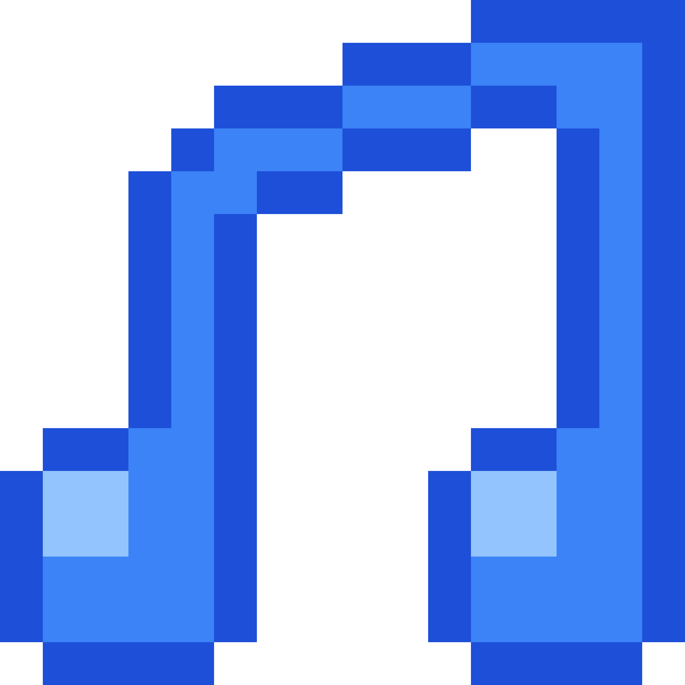
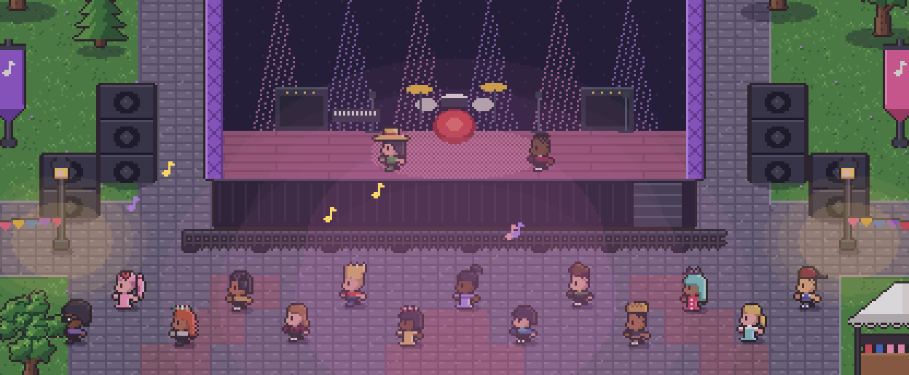
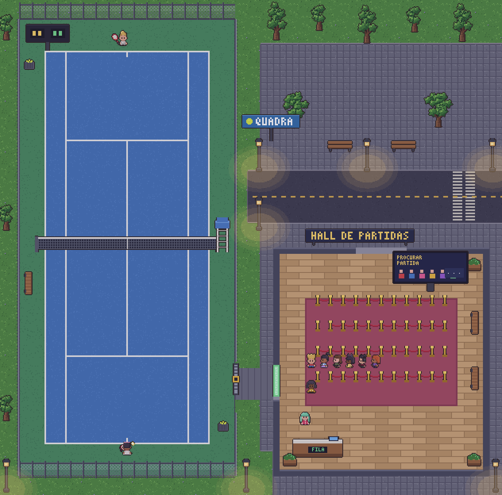
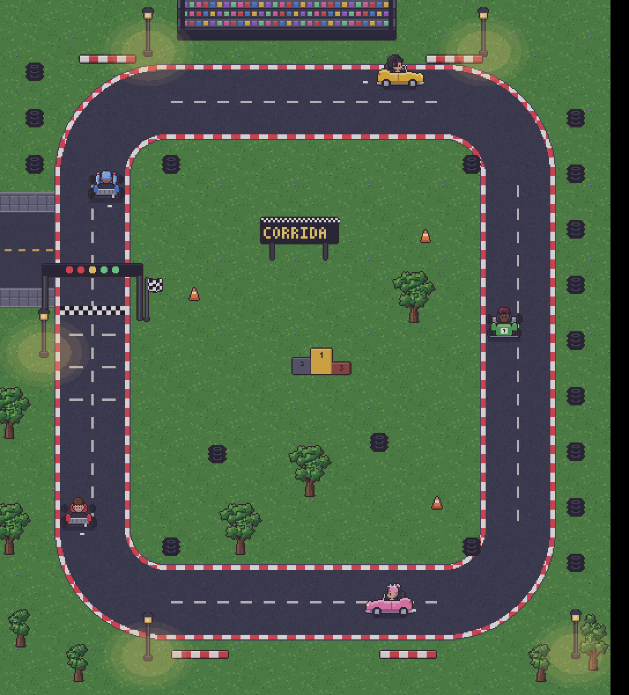

<div align="center">



# bumbadum

### A tiny online room for big shared moments.

Walk in. Say hi. Put on a song. Stay a while.

<a href="https://bumbadum.vercel.app" target="_blank" rel="noopener noreferrer">🎧 Try it live</a>

<p>
  <a href="#what-is-bumbadum">What it is</a> ·
  <a href="#the-interesting-part">The interesting part</a> ·
  <a href="#spec-driven-development">How it is built</a> ·
  <a href="#run-it-locally">Run it locally</a> ·
  <a href="#architecture">Architecture</a>
</p>

<p>
  
  
  
  
</p>

</div>

<div align="center">



</div>

## What is bumbadum?

bumbadum is a cozy multiplayer room: friends choose a nickname and an avatar, walk around a shared top-down plaza, chat, and control one radio together.

The small twist is the important one: **the music is part of the room, not a separate tab**. When someone types `/play`, the track enters a shared queue. Everyone hears the same song at the same moment, including people who join late.

It is deliberately small, social, and a little bit magical — but the engineering underneath is serious.

## The experience

<table>
  <tr>
    <td width="50%" valign="top">
      <h3>🗺️ A room you can inhabit</h3>
      <p>Walk through a handcrafted pixel-art plaza with collision, depth sorting, camera following, speech bubbles, and animated avatars.</p>
    </td>
    <td width="50%" valign="top">
      <h3>📻 One radio, one timeline</h3>
      <p>Queue YouTube tracks from chat. The server owns the timeline; clients estimate clock offset and seek to the correct playback position.</p>
    </td>
  </tr>
  <tr>
    <td width="50%" valign="top">
      <h3>💬 Chat as the control surface</h3>
      <p><code>/play</code>, <code>/skip</code>, and <code>/help</code> keep the room conversational. Portuguese command aliases work for everyone too.</p>
    </td>
    <td width="50%" valign="top">
      <h3>🧢 A personal little character</h3>
      <p>Compose avatars from generated, palette-aware layers. Nickname, avatar, theme, language, and volume stay local — no account required.</p>
    </td>
  </tr>
</table>

<div align="center"><sub>Six dancers. One radio. One shared beat.</sub></div>

## More ways to play

The plaza is growing beyond the dance floor. Challenge friends to a rally on the tennis court or take a car around the race track — all in the same shared world.

<table>
  <tr>
    <td width="50%" align="center" valign="top">
      
    </td>
    <td width="50%" align="center" valign="top">
      
    </td>
  </tr>
</table>

## The interesting part

### A shared radio without a host client

The server stores the current track and its `startedAt` timestamp in server time. Each browser performs a lightweight NTP-style clock sync, calculates:

```text
playback position = estimated server time - track.startedAt
```

The local YouTube player corrects only when drift crosses a small threshold. There is no “host” browser to disconnect, no client-sent timestamp to trust, and a late joiner lands in the right place automatically.

### Authoritative movement, lightweight clients

Clients send intents such as `step` and `chat`. The Colyseus room validates and rate-limits those messages, applies movement against the server-owned map, and broadcasts the resulting state. The browser can predict a step for responsiveness, then reconcile against the server's handled-intent count.

### Art and rules generated from the same source

The Tiled project is the canonical map source. A generator produces the walkability grid, spawn point, floor image, light overlay, object atlas, and typed object placements. Avatar generators do the same for wearable catalogs and sprite atlases. That keeps what the player sees and what the server considers walkable on the same source of truth.

### One responsive room, not two applications

The desktop and compact room share one component tree. Below the compact breakpoint, the screen, chat, queue, and players become a sheet without remounting the PixiJS canvas or the YouTube player. This preserves playback and connection state while the layout changes around it.

## Architecture

```text
                         ┌──────────────────────────┐
                         │       Next.js web         │
                         │ React UI · PixiJS · Screen│
                         └────────────┬─────────────┘
                                      │ WebSocket intents + patches
                                      ▼
                         ┌──────────────────────────┐
                         │    Colyseus lobby-room    │
                         │ validation · rate limits │
                         │ composition root         │
                         └──────┬────────┬──────────┘
                                │        │ adapters
                 ┌──────────────┘        └───────────────┐
                 ▼                                       ▼
       ┌──────────────────────┐                ┌──────────────────┐
       │     protocol          │                │ YouTube services │
       │ schemas + message    │                │ URL lookup +     │
       │ contracts             │                │ cached search    │
       └──────────┬───────────┘                └──────────────────┘
                  ▼
       ┌────────────────────────────────────────────────────┐
       │ Pure domain packages: world · radio · chat · avatar │
       │ no I/O · no timers · no framework dependencies      │
       └────────────────────────────────────────────────────┘
```

The dependency direction is intentional:

```text
domain packages  ←  protocol  ←  game-engine  ←  apps
```

The server is the composition root. Pure packages hold rules; protocol holds the network contract; the game engine owns the imperative PixiJS lifecycle; React owns the room UI and overlays.

## Tech choices, with a reason

| Concern | Choice | Why it fits |
| --- | --- | --- |
| Web shell | Next.js App Router + React | A fast product shell around a long-lived game surface |
| World renderer | PixiJS | An imperative, performant canvas API for pixel-art rendering |
| Realtime state | Colyseus + WebSockets | Rooms, reconnection, schema patches, and an authoritative server model |
| Domain logic | Pure TypeScript packages | Rules stay testable without browsers, sockets, or service fakes |
| Validation | Zod + protocol schemas | Trust boundaries are explicit on both server and client |
| Styling | Tailwind CSS + shadcn/ui | Fast iteration without hiding UI primitives inside a design system |
| Workspace | pnpm + Turborepo | Shared packages, cached tasks, and a single development loop |
| Quality | Biome + Vitest + Playwright | Formatting, unit behaviour, and multi-client flows in one gate |
| Hosting | Vercel + Render | Web delivery separated from the long-lived multiplayer process |

## Project structure

```text
apps/
  web/          Next.js shell, room UI, PixiJS mount, chat, screen
  server/       Colyseus room, adapters, rate limiting
packages/
  world/        map, tiles, collision, movement
  radio/        queue, now playing, skip vote, clock sync
  chat/         message rules and command parsing
  avatar/       appearance model, validation, sprite manifest
  protocol/     Colyseus schemas and message types
  game-engine/  imperative PixiJS renderer
  tooling/      shared TypeScript configuration and generators
assets/
  map/          canonical Tiled map source
  avatar/       canonical first-party avatar layers
```

## Run it locally

### Requirements

- Node.js 24+
- Corepack (included with Node.js)
- A YouTube Data API v3 key for real `/play` lookups

### Install and start

```bash
corepack enable
pnpm install

cp apps/server/.env.example apps/server/.env
cp apps/web/.env.example apps/web/.env.local
```

Set the server-only key in `apps/server/.env`:

```dotenv
YOUTUBE_API_KEY=your_key_here
```

Then start both apps:

```bash
pnpm dev
```

Open [localhost:3000](http://localhost:3000). The web app connects to the Colyseus server at `localhost:2567` by default.

The end-to-end suite uses fake music services, so it does not need a YouTube key or consume API quota.

## Try the room

Type these into the chat:

| Command | What happens |
| --- | --- |
| `/play <YouTube URL or name>` | Adds a track to the shared queue |
| `/skip` | Votes to skip the track; the submitter can skip immediately |
| `/help` | Shows the available commands |

Portuguese aliases are available too: `/tocar`, `/pular`, and `/ajuda`.

## Spec-driven development

bumbadum is developed from written decisions, not from a backlog of vague feature names. Before implementation starts, a feature is turned into an explicit contract: the problem it solves, the experience it should create, the architectural constraints it must respect, how it will be tested, and what is deliberately out of scope.

```text
open questions
      ↓  grilling · prototype · research
feature spec
      ↓  tracer-bullet tickets
vertical slices
      ↓  red · green · refactor
review against the spec
      ↓
green main
```

| Artifact | What it protects |
| --- | --- |
| **Feature spec** | Problem statement, user stories, implementation decisions, test strategy, boundaries, and delivery order |
| **Ticket** | One independently verifiable vertical slice, small enough for a focused implementation session |
| **Prototype or research note** | Decisions that should be learned before production code is committed, such as movement feel or clock drift |
| **Glossary** | One shared language across product copy, TypeScript, tests, and protocol messages |
| **ADR** | The reasoning behind decisions that would be expensive to reverse |
| **Review** | The finished diff is checked against both repository standards and the original spec |

Specs and tickets live as local Markdown under [`.scratch/`](.scratch/), so the plan is versionable, readable by humans, and directly usable by coding agents. Larger features follow a full discovery → spec → tickets → implementation flow; smaller changes use a lighter grilling → TDD → review loop.

The implementation order follows the architecture. A slice normally begins as a pure domain behaviour and a failing test, crosses the protocol boundary, is wired into the authoritative room, and only then reaches the web UI. Prototypes gate uncertain behaviour; ADRs capture durable decisions; `pnpm check` and the relevant multi-client Playwright flows prove the slice before it lands on `main`.

For concrete examples, see the [MVP spec](.scratch/mvp/spec.md), the [plaza map spec](.scratch/plaza-map/spec.md), and the plaza's [tracer-bullet tickets](.scratch/plaza-map/issues/).

## Development loop

```bash
pnpm check       # Biome + typecheck + Vitest across the workspace
pnpm test:e2e    # Playwright multi-client flows
pnpm build       # Production builds
pnpm format      # Apply Biome fixes
```

Architecture decisions live in [`docs/adr/`](docs/adr/), terminology in [`GLOSSARY.md`](GLOSSARY.md), and repository conventions in [`CODING_STANDARDS.md`](CODING_STANDARDS.md).

## Status

bumbadum is an early-stage, desktop-oriented MVP with one lobby, no accounts, and no persistent server data. The foundations are intentionally ready for more rooms, richer spaces, and a larger social layer without moving game rules into the UI or network layer.

<div align="center">

<br />
<sub>Made for the friends who say “one more song” and mean it.</sub>

</div>
